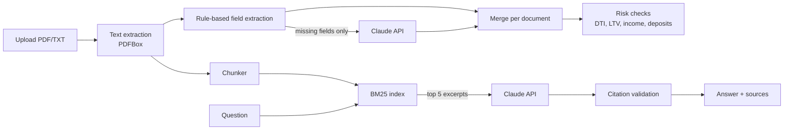

# Loan Document Analyzer

[](https://github.com/junaidahmed9909/loan-document-analyzer/actions/workflows/ci.yml)

Loan processors spend hours reading the same kinds of documents: applications, pay stubs, bank statements. They pull out the same ten numbers, do the same math, and hunt for the same red flags. Then someone asks "where's the down payment coming from?" and they go digging again.

This app does the first pass for them. Upload an applicant's documents and you get the key figures, the debt-to-income and loan-to-value math, a list of risk flags with plain-English reasons, and a box where you can ask questions and get answers that cite the exact page they came from.

**Stack:** Java 21 · Spring Boot 3.5 · Apache PDFBox · Claude Messages API (via Spring `RestClient`) · BM25 retrieval · vanilla JS UI · Docker · GitHub Actions

> All sample documents in `sample-docs/` are fictional. Don't upload real customer data to a demo.

---

## What it does

1. **Reads documents.** PDFs page by page with PDFBox, plus TXT/MD/CSV.
2. **Extracts fields with rules first.** Name, employer, income, debts, loan amount, property value, credit score, rate and term. Each value comes with the exact line it was read from, so it's auditable. Pay stubs are converted to monthly income based on pay frequency (weekly, biweekly, semi-monthly, monthly).
3. **Fills the gaps with an LLM (optional).** Only fields the rules missed are sent to the model, and the model's values can never overwrite rule-based ones.
4. **Runs underwriting checks:**

   | Flag | Rule |
   |---|---|
   | `HIGH_DTI` / `ELEVATED_DTI` | DTI above 43% / 36%, including the estimated new payment when rate and term are known |
   | `LTV_ABOVE_80` / `HIGH_LTV` | LTV above 80% (mortgage insurance likely) / above 95% |
   | `LOW_CREDIT_SCORE` / `FAIR_CREDIT_SCORE` | Below 620 / 620–679 |
   | `INCOME_MISMATCH` | Monthly income differs by more than 10% between documents |
   | `LARGE_DEPOSIT` | A non-payroll deposit worth half a month's income or more |
   | `MISSING_INCOME`, `MISSING_DATA` | Key facts not found anywhere |

5. **Answers questions with citations.** The question is matched against document chunks with BM25, the top five excerpts go to the model, and the model must cite them as `[1]`, `[2]`. Citations that don't point at a real excerpt are thrown out, and an answer with no valid citation is marked as ungrounded.

**No API key? It still works.** Extraction and risk checks are fully rule-based, and questions return the most relevant passages instead of a written answer.

## Architecture



The `core/` package is plain Java with no Spring imports: chunking, BM25, extraction, risk rules, prompts and citation checks. The Spring layer handles HTTP, file parsing and the LLM call.

## Quick start

You need Java 21 and Maven 3.9+.

```bash
# Optional: turn on AI answers and gap-filling
export ANTHROPIC_API_KEY=your-key-here

mvn spring-boot:run
```

Open http://localhost:8080, upload the three `james-carter-*` files from `sample-docs/`, and ask "Where is the down payment coming from?"

Or with Docker:

```bash
docker build -t loan-analyzer .
docker run -p 8080:8080 -e ANTHROPIC_API_KEY=$ANTHROPIC_API_KEY loan-analyzer
```

## API

```bash
# Analyze a case
curl -s -F files=@sample-docs/james-carter-application.txt \
        -F files=@sample-docs/james-carter-paystub.txt \
        -F files=@sample-docs/james-carter-bank-statement.txt \
        http://localhost:8080/api/cases | jq '{id, risk: .risk.level, flags: [.risk.flags[].code]}'

# Ask a question
curl -s -H 'Content-Type: application/json' \
  -d '{"question":"Why might the income be inconsistent?"}' \
  http://localhost:8080/api/cases/<id>/questions | jq

# Fetch a case again, or check which mode is on
curl -s http://localhost:8080/api/cases/<id>
curl -s http://localhost:8080/api/status
```

## Configuration

| Property | Env var | Default |
|---|---|---|
| `llm.api-key` | `ANTHROPIC_API_KEY` | empty (search-only mode) |
| `llm.model` | `LLM_MODEL` | `claude-haiku-5-5` |
| `llm.base-url` | `LLM_BASE_URL` | `https://api.anthropic.com` |
| `llm.extraction-enabled` | | `true` |
| `llm.timeout` | | `PT60S` |

Model names change over time; check the [Claude models overview](https://platform.claude.com/docs/en/about-claude/models/overview) if a request fails with an unknown model.

## Testing

```bash
mvn verify
```

- **Extraction accuracy:** `FieldExtractorTest.extractsSampleDocumentsAccurately` checks every labelled field in the sample documents against ground truth.
- **End-to-end:** upload, analysis, Q&A, PDF parsing and error handling through MockMvc.
- **LLM client:** the exact Messages API request (headers, model, body) and error handling, using a mock server, so tests never hit the network.

To make the accuracy number more meaningful, add more varied documents (different layouts and wording) to `sample-docs/` and their expected values to the test. Then record it here:

| Measurement | Result |
|---|---|
| Field accuracy, rules only (N documents) | _fill in_ |
| Field accuracy, rules + LLM (N documents) | _fill in_ |
| Answers with valid citations (N questions) | _fill in_ |

## Design decisions worth talking about

- **Rules first, LLM second.** Rules are free, instant and explainable. The LLM is only used where it adds something, which also keeps costs low.
- **Why BM25 instead of embeddings?** Loan questions are full of exact terms like employer names, "gross pay" and dollar amounts, where keyword ranking does well. It also needs no second API, is deterministic, and runs in microseconds. Swapping in vector search (for example pgvector) would mean adding another retriever behind the same search call.
- **Citation validation.** Models sometimes cite sources that don't exist. Checking every citation number against the excerpts actually sent is a cheap guardrail against that.
- **Privacy by default.** Cases live in memory and are capped at 100. Nothing is written to disk.
- **What I'd add next:** OCR for scanned PDFs (Tesseract), a database-backed case store with encryption at rest, vector search alongside BM25, and an evaluation set of 50+ varied documents.

## Project layout

```
src/main/java/com/junaid/loan
├── core/      chunker, BM25 index, field extractor, bank statement parser, risk rules, prompts
├── llm/       LLM client interface and the Claude implementation
├── service/   text extraction, analysis pipeline, in-memory case store
├── api/       REST controller, response views, error handling
└── config/    bean wiring
src/main/resources/static/index.html   single-page UI
sample-docs/                           fictional applications, pay stubs and bank statements
```
